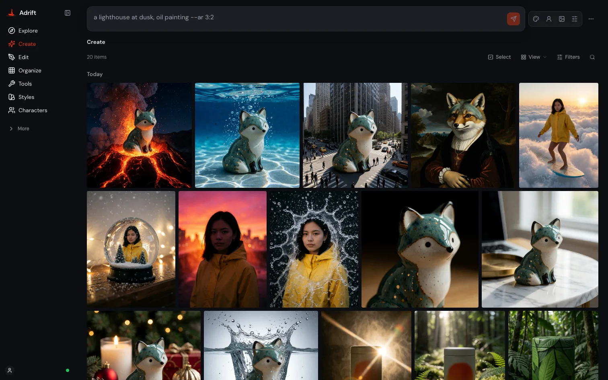
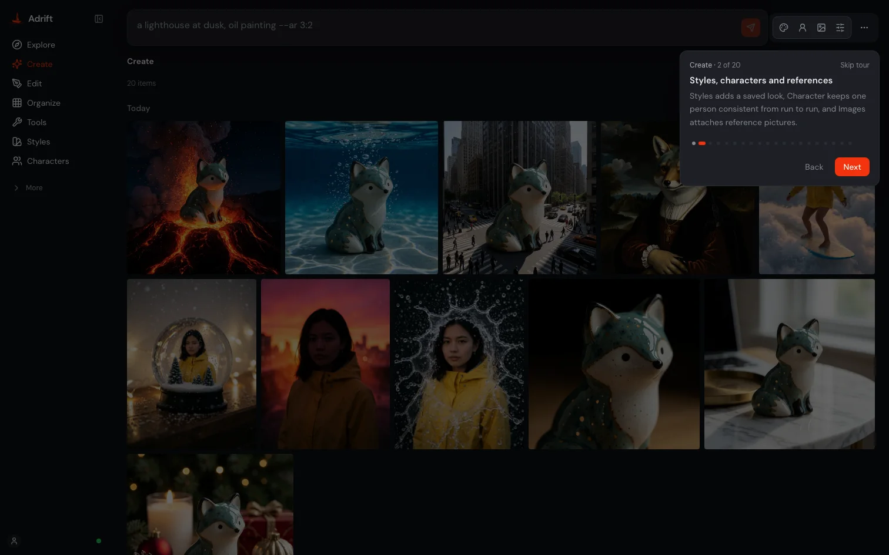
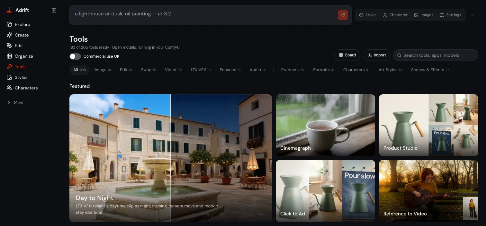
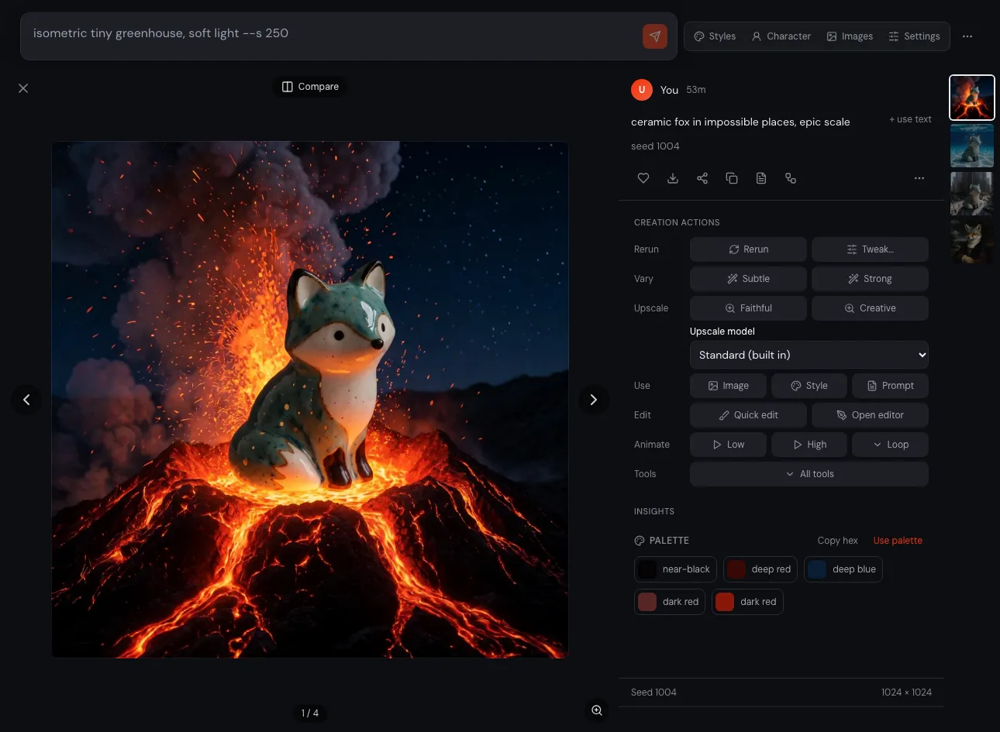
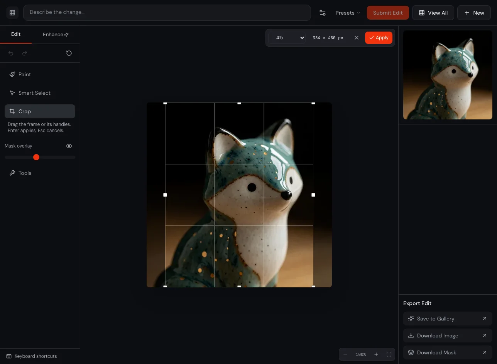
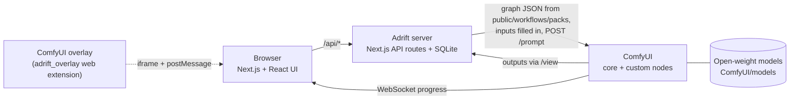

# Adrift

**An open-source creative studio for ComfyUI. One web app to prompt, edit,
animate, voice and score images and clips with open-weight models on your own
GPU: 135 tools + 82 app templates that rebuild a hosted AI
studio's menu, each one a plain ComfyUI workflow you can open and change.**

[](https://github.com/xk44/adrift/actions/workflows/ci.yml)
[](docs/HIGGSFIELD.md)


[](LICENSE)


- **No credits, no account.** Every tool runs on your own ComfyUI. There is nothing to buy and nothing to sign up for.
- **Your work stays on your machine.** Prompts, uploads and results are not sent anywhere; Adrift listens on `127.0.0.1` by default.
- **Open weights only: no partner nodes or APIs.** Every shipped graph runs
  local open-weight models in your own ComfyUI; nothing calls a hosted
  inference service. See [Open weights only](#open-weights-only-no-partner-nodes-or-apis).
- **Every tool is an editable ComfyUI graph.** Each card runs a plain API-format workflow from `public/workflows/packs/`. Open it in ComfyUI to see exactly what runs, or change it.


<!-- VIDEO, when ready: **[Watch the demo (under 2 min)](VIDEO_URL)** -->

[Quick start](#quick-start) ·
[Try it without a GPU](#try-it-without-a-gpu-2-minutes) ·
[Higgsfield coverage](docs/HIGGSFIELD.md) ·
[Full setup](docs/SETUP.md) ·
[All tools](docs/TOOLS.md)

The repository ships **no model weights** and no image or style datasets. You
download the models you want, and each one is covered by its own license (see
[Models and licenses](#models-and-licenses)).

## Why a local studio

|                       | Hosted AI studio (credits)    | Adrift                                               |
| --------------------- | ----------------------------- | ---------------------------------------------------- |
| Cost per run          | credits                       | nothing; your own GPU and power                      |
| Where your media goes | uploaded to the provider      | stays on your machine                                |
| Models                | the provider's choice, closed | open-weight models you pick ([MODELS.md](MODELS.md)) |
| How a tool works      | hidden                        | a ComfyUI graph you can open, edit and re-run        |
| Offline               | no                            | yes, once the models are downloaded                  |

New to it? The first run asks where your ComfyUI is (this machine, another
machine on your network, or none yet), picks starter models that fit your
VRAM, and then a 20-stop guided tour walks through every page. You can restart
the tour any time from **Help**.



<!-- TIMING, when measured: "A 5 s 720p clip: $0 and about N min on an RTX 4090." -->

Adrift also lives inside ComfyUI: press **Ctrl+Shift+J** on the ComfyUI canvas
to open Adrift over the graph, mirror the current workflow into it, send a
workflow back to the canvas, or drag a gallery image in as a `LoadImage` node
(see [Architecture](#architecture)).

<!-- SCREENSHOT overlay, when ready:

-->

## Quick start

You need [Node.js](https://nodejs.org) 20+ (LTS) and git.

```bash
git clone https://github.com/xk44/adrift.git && cd adrift
./install.sh     # Windows: install.cmd
./adrift         # Windows: adrift.cmd
```

The installer checks your tools, installs the app's packages, finds your
ComfyUI or offers to install one (v0.42+ with GPU PyTorch, about 6 GB; Python
3.10 to 3.13 needed for that), writes `.env.local` and builds the app. It asks
before each step and downloads no models. `./adrift` starts ComfyUI and the
app and opens the setup wizard in your browser, which suggests starter models for your
GPU and gives you the download command to run. Krea 2, Create's default image
engine, also needs two custom node packs: answer yes to the node packs question,
or pass `--packs`.

- **ComfyUI on another machine:** forward its port over SSH
  (`ssh -N -L 8188:127.0.0.1:8188 gpu-box`) and keep the defaults. ComfyUI has
  no login, so don't open its port to the network ([Ports](docs/SETUP.md#ports)).
- **Docker:** see [Docker](docs/SETUP.md#docker).
- **Options:** `--comfy PATH`, `--install-comfy [DIR]`, `--no-comfy`,
  `--packs` (pinned custom node packs), `--yes` (no questions), `--dry-run`
  (show the plan, change nothing); on Windows `-Comfy`, `-InstallComfy`,
  `-NoComfy`, `-Packs`, `-Yes`, `-DryRun`. Re-running is safe. The steps by
  hand: [Manual install](docs/SETUP.md#manual-install).

## Try it without a GPU (2 minutes)

A mock ComfyUI (`scripts/mock-comfy/`) answers with recorded fixtures and
placeholder weights, so you can click through every page and every tool card
on a laptop. No model runs: a job shows a few seconds of fake progress, then
returns a bundled sample image or clip. Node.js 20+; on Windows use Git Bash
or WSL.

```bash
git clone https://github.com/xk44/adrift.git && cd adrift
./install.sh --no-comfy --no-build --yes
./adrift --mock
```

It opens `http://127.0.0.1:3100`. Every tool shows as installed; pressing Run
finishes with a sample result (the same picture for every prompt). [scripts/mock-comfy/README.md](scripts/mock-comfy/README.md)
also has a headless crawl that opens every card.

## Model sets

Adrift ships no weights. `scripts/fetch-models.mjs` downloads pinned files from
Hugging Face into `$COMFY_ROOT/models` and never deletes or overwrites a file.
You don't need a whole set: the setup wizard's **Pick single tools instead**
ticks tools one by one, shows what fits your GPU, and builds the command. By
hand, `--tool a,b` fetches those tools and `--skip <file>` leaves a file out.

| Set         | Size    | What it covers                                                                                                                                                                                                                  |
| ----------- | ------- | ------------------------------------------------------------------------------------------------------------------------------------------------------------------------------------------------------------------------------- |
| **Starter** | ~11 GB  | `--set starter`: SDXL text to image, background removal (image and video), sound effects. Add Real-ESRGAN (67 MB, printed as a manual step) for Upscale.                                                                        |
| **Minimal** | ~272 GB | `--set minimal`: what the default tools load: the video models (Wan2.2, LTX-2.5), edit, upscale, 3D and audio. Most of it is the video diffusion models and their text encoders, so fetch per tool unless you want all of them. |
| **Full**    | ~1,040 GB | `--set full`: Minimal plus the pack and edit-tool models, motion LoRAs, TTS voices and alternative quantizations.                                                                                                               |

The exact files and sizes are in [models/download-list.md](models/download-list.md).

## Hardware

Adrift is built for a **single 24 GB NVIDIA GPU** (RTX 3090 / 4090 class) with
32 GB+ system RAM. ComfyUI loads and releases text encoders and VAEs per stage,
so what decides the tier is the largest diffusion model a tool loads. Each
tool's ballpark is in the VRAM column of [docs/TOOLS.md](docs/TOOLS.md).

| Tier                    | What runs                                                                                                                                                                                                                                                                                                                                                                                                                                                           |
| ----------------------- | ------------------------------------------------------------------------------------------------------------------------------------------------------------------------------------------------------------------------------------------------------------------------------------------------------------------------------------------------------------------------------------------------------------------------------------------------------------------- |
| **NVIDIA 24 GB**        | 102 of the 130 tool rows in docs/TOOLS.md (one per engine) at full speed, including the Wan2.2 video tools, talking avatars, Relight / Shots / Zooms (Qwen-Image-Edit 2509), Layers and FIBO 2.0. Another 18 (Krea 2 bf16 and Qwen-Image-Edit 2511) also run here with ComfyUI's model offloading, more slowly. The fp8 / GGUF quantizations in the download list shrink them.                                                             |
| **NVIDIA 16 GB**        | 47 of those workflows (a 12 GB card runs the 8 and 12 GB ones): Qwen-Image 2.1 and FLUX.3 Klein edits, most catalog LoRA tools, SeedVR2 upscale, LTX-Video animate, Make 3D (TRELLIS.2 / Pixal3D), music and sound, plus the CPU and light tools (vectorize, background removal, Real-ESRGAN, RIFE slow-mo, voiceover). Larger tools fall back to ComfyUI's offloading, which is slow.                                                                      |
| **Apple Silicon (MPS)** | Image and edit tools with **bf16 or GGUF** weights. MPS has no fp8 support, so skip the `fp8` files. Unified memory has to hold the bf16 weights: 32 GB covers the FLUX.3 Klein tools, while Krea 2, MOSS-Image and the Qwen-Image edit models want 64 GB or more. Video runs on the Wan2.2 GGUF files and is much slower than on CUDA; if fp16 video comes out black, use a separate fp32 ComfyUI instance (see [Troubleshooting](docs/SETUP.md#troubleshooting)). |

These are weights-only ballparks. Resolution, frame count and batch size add on
top. Disk sizes for each model set are in [Model sets](#model-sets).

## Higgsfield tools, open

Adrift was built for Comfy's _Open Source Higgsfield_ challenge. The goal was to
take a hosted studio's tool menu and rebuild it as ComfyUI workflows on
open-weight models that you run yourself.
[docs/HIGGSFIELD.md](docs/HIGGSFIELD.md) maps each Higgsfield tool and app to
the Adrift action that covers it, and states the gap wherever coverage is
partial. Of 83 core Higgsfield tools, 63 are covered and run on the reference backend, 12 are built but untested, and 8 are partly covered; the map also covers its one-click apps. Higgsfield names are used only to identify a
feature; Adrift has no affiliation with Higgsfield.



| Section     | What is in it                                                                                                                                                                                                                                       |
| ----------- | --------------------------------------------------------------------------------------------------------------------------------------------------------------------------------------------------------------------------------------------------- |
| **Image**   | Text to image on Krea 2, Qwen-Image 2.1, FLUX.3 Klein, MOSS-Image, Wan and SDXL packs; style presets, Photo Dump, What If, Storyboard, Restyle                                                                                                      |
| **Edit**    | Instruction edit (Krea 2 edit LoRAs, Qwen-Image 2.1, FLUX.3 Klein, FIBO 2.0), inpaint, outpaint and zoom-out, object and background removal, Layers, Vectorize, Breakdown                                                                           |
| **Swap**    | Character swap (photo), character sheet, outfit swap, AI Stylist; face and character swap in video (optional MiniMax H3 pack)                                                                                                                       |
| **Video**   | Image to video, motion and VFX presets, camera control, trajectory motion, talking avatars and lipsync, restyle / reframe / extend video, object removal, slow-mo, video upscale, LTX-2.5 VFX (alpha matte, clean plate, day to night, cinemagraph) |
| **Enhance** | Upscale (Real-ESRGAN, SeedVR2), face and skin enhance, relight, Shots (nine camera setups), Zooms, color grade                                                                                                                                      |
| **Apps**    | One-click templates (ads and products, fashion, social formats), plus the Shorts Studio and Click to Ad pipelines (idea or product photo in, finished clip out)                                                                                     |
| **Audio**   | Voiceover with voice cloning, music, sound effects, add sound to a clip, Video Translator (transcribe, translate, re-voice, lipsync; several speakers in Audio only, on an NVIDIA or AMD GPU)                                                                                                                |
| **3D**      | Make 3D (TRELLIS.2, with Pixal3D as an alternative) with an in-browser GLB viewer; 3D splat (TripoSplat) to `.ply` or `.spz`; Export for Blender, Export FBX and Export for Three.js. [Three.js](docs/THREEJS.md), [TouchDesigner](docs/TOUCHDESIGNER.md) and [Blender, Unity and Unreal](docs/GAME_ENGINES.md) notes                                                                                                                                                                   |

Around the Tools page, the **Create** page has a prompt bar with inline
parameters (`--ar 16:9`, `--seed 42`, `--sref <image>`, `--video`) and a live
run feed, plus a lightbox to vary, upscale, edit, animate or compare a result.
The app also has a **Storyboard** (one premise becomes 4 to 8 consistent frames,
then "Animate all"), **Cinema controls** (camera, lens, look and movement
compiled into the video prompt), moodboards, saved characters and a task queue.



The full list is in [docs/TOOLS.md](docs/TOOLS.md): every tool with what it
does, the models it loads, its commercial status and a VRAM ballpark. The Tools
page shows the same cards with a license badge and an install check on each.

Every action can also be called over HTTP (`POST /api/jobs/action`, see
[docs/tools-api.md](docs/tools-api.md)).

### Since the first release

- **MCP server for agents.** `scripts/adrift-mcp.mjs` lets Claude Code, Codex
  or any MCP client list and run Adrift's tools and fetch the results. It
  speaks stdio only and never opens a port. Setup: [docs/MCP.md](docs/MCP.md).
- **More than one ComfyUI machine.** Add extra ComfyUI backends in Settings and
  either pin a tool to a machine ("always run upscales on the desktop") or let
  auto-routing pick one that has every node and model the graph needs, ranked
  by how busy it is. A job that never reached a machine fails over to the next
  one; a job that might have started is never sent twice.
- **Long clips on MiniMax H3.** Reference to Video can chain clips past one
  generation's length, with a per-subject **Fix faces** pass that keeps two
  people's faces from blending.
- **Video QC.** Every finished clip is checked with ffmpeg for black frames,
  freezes, hard jumps, silence or missing audio and the wrong length, frame rate
  or size. The result shows as a badge, and a failed clip is re-rolled with a
  new seed, automatically or with one click.
- **Crop in the editor.** Press **C** for a crop frame with aspect presets
  (1:1, 4:5, 9:16, 16:9 and more) and a live output size.
- **Training guards.** LoRA training checks steps, rank, resolution and
  learning rate before it starts, and stops a run that has too few usable
  images instead of training on them.
- **Safety-filter blanks.** An Ideogram output that comes back as a flat blank
  canvas is marked as filtered, and the run is re-rolled once with a new seed.



## LTX-2.5 VFX

**LTX-2.5** (Lightricks, 22B distilled, open weights) is Adrift's core video
model. It is the default engine for **Animate image**, for the clips in the
**Click to Ad** and **Shorts Studio** pipelines and for **Expand video**, and it
powers a dedicated **LTX VFX** category on the Tools page. Every LTX graph in
[`public/workflows/packs/ltx25/`](public/workflows/packs/ltx25) uses core
ComfyUI nodes only: no custom node pack is needed.

| Tool                 | What it does                                                                                     | Input          | LoRA on top of LTX-2.5 22B                     |
| -------------------- | ------------------------------------------------------------------------------------------------ | -------------- | ---------------------------------------------- |
| Animate (LTX-2.5)    | A still becomes a clip **with sound** (video and audio in one pass), 8+3 distilled steps         | image + prompt | none                                           |
| Transition (LTX-2.5) | A clip with sound that moves from a start frame to an end frame                                  | 2 images       | none                                           |
| Alpha Matte          | A black-and-white matte of the subject (white = keep) to use as a luma matte when compositing    | video, 4 s     | IC-LoRA Alpha-Gen 0.9                          |
| Clean Plate          | Removes the people from a shot and returns the empty background plate; no mask needed            | video, 4 s     | IC-LoRA Clean-Plate 1.0                        |
| Day to Night         | Relights a daytime clip as night; framing, camera move and motion stay identical                 | video, 4 s     | IC-LoRA Day-To-Night 0.9                       |
| Add Water            | Adds floods, rain, splashes or wet streets; people and framing stay identical                    | video, 5 s     | IC-LoRA Water-Simulation 0.9                   |
| Cinemagraph          | One element of a photo moves (steam, hair, a waterfall) while the rest holds, as a seamless loop | image + prompt | Cinemagraph LoRA 0.9                           |
| Slow Motion          | Animates a photo as true slow motion, from 2× to 40× slower                                      | image + prompt | Slow-Motion-Control LoRA 1.0                   |
| Expand video         | Zooms out or widens a clip; only the new border is generated                                     | video, 5 s     | LTX-2.3 IC-LoRA Outpaint (community, oumoumad) |

The four IC-LoRA tools are video to video: the source clip is the in-context
reference, so the output keeps its timing and camera move, and source audio is
kept. Adrift sizes each job to the LoRA's training resolution and frame count
(8n+1 frames at 24 fps) and wraps your words in the prompt template from the
model card.

**Models.** All LTX tools share one base set: the LTX-2.5 22B distilled
transformer (int8, 21.5 GB), the Gemma 4 12B text encoder (int8, 15.4 GB), the
LTX-2.5 video and audio VAEs and the x2 latent upscaler. Each effect then adds
one LoRA of 0.2 to 1.3 GB, so about 40 GB of disk covers the base plus any one
effect. The Lightricks repositories are gated: accept the license on
[Lightricks/LTX-2.5](https://huggingface.co/Lightricks/LTX-2.5) and on each LoRA
page before you download. Exact files are in
[models/download-list.md](models/download-list.md); fetch one tool with
`node scripts/fetch-models.mjs --tool ltx_alpha_matte` (any tool id works).

**VRAM.** Every LTX tool is rated **24 GB** in [docs/TOOLS.md](docs/TOOLS.md).
ComfyUI loads the text encoder, encodes the prompt and releases it before the
22B transformer samples, so a 24 GB card with 32 GB+ of system RAM runs them
(tested on an RTX 4090). Longer clips and the 1280 px Expand video option need
more VRAM than the defaults.

**License.** LTX-2.5, its VAEs, the latent upscaler and all the LTX VFX LoRAs
are under the
[LTX-2 Community License](https://github.com/Lightricks/LTX-2/blob/main/LICENSE-2_x):
free to use, including commercially, for entities under US$10M in yearly
revenue; above that you need a paid license from Lightricks. The Gemma 4 text
encoder is under the [Gemma Terms of Use](https://ai.google.dev/gemma/terms).
The app shows these tools with a **Revenue cap** badge.

## Audio

Adrift's audio tools run **Stable Audio 3** inside ComfyUI. The small SFX model
(in the Starter set) drives **Sound effect**; the **Medium** model adds **Text
to audio**, **Restyle** (keep a clip's timing, change its sound), **Fix a
section** and **Extend**. You can also **train an audio LoRA** on your own
clips. Setup, licence and the LoRA converter are in
[docs/SETUP.md](docs/SETUP.md#audio-stable-audio-3).

## FLUX 3

**FLUX.3 Klein** is the core model of a set of image tools. Each one runs a
plain graph from `public/workflows/packs/flux3/` (or a catalog LoRA on the same
base) on your own GPU:

| Where                 | What FLUX.3 Klein does                                                                                                                                |
| --------------------- | ----------------------------------------------------------------------------------------------------------------------------------------------------- |
| **Create** page       | Text to image and image to image (`flux3` pack: base 50 steps at CFG 3.5, or the step-distilled checkpoint at 16 steps, CFG 1)                        |
| **Edit (FLUX.3)**     | Instruction edit that grounds the source image with reference latents; a Speed option switches base / step-distilled                                  |
| Camera angle, Restore | Catalog LoRA tools on the FLUX.3 Klein base (angles and restore LoRAs)                                                                                |
| Edit-engine pickers   | "FLUX.3" is an engine choice in Remove Text, Headshot Generator, Skin Enhancer, Photo Dump, What If, Commercial Faces, AI Stylist and Fashion Factory |

- **Models:** `flux3_image_klein_bf16.safetensors` (base; the repo's
  `flux3-image-klein-base-bf16.safetensors`) and/or
  `flux3_image_klein_sd_bf16.safetensors` (step-distilled; the repo's
  `flux3-image-klein-bf16.safetensors`), about 11 GB each, from
  [black-forest-labs/flux-3-image-klein-comfy](https://huggingface.co/black-forest-labs/flux-3-image-klein-comfy)
  (gated: accept the license on Hugging Face first), plus the
  `qwen3vl_4b_bf16.safetensors` text encoder (CLIP type `flux3`) and
  `flux2-vae.safetensors`. Exact files are in
  [models/download-list.md](models/download-list.md).
- **License:** [FLUX Kommunity License v1.0](https://huggingface.co/black-forest-labs/flux-3-image-klein/blob/main/LICENSE.md).
  It has a **revenue cap**: commercial use of outputs is allowed only for
  businesses under US$5M gross yearly revenue, otherwise non-commercial. The
  app marks these cards `restricted` (see [MODELS.md](MODELS.md)).
- **VRAM:** the tools fit a **16 GB** NVIDIA card. ComfyUI loads the 9 GB text
  encoder and the 11 GB diffusion model one stage at a time, so a 24 GB card
  runs them without offloading. On Apple Silicon use the bf16 files (no fp8 on
  MPS); 32 GB of unified memory is enough.
- **Local open weights only.** The `flux3` pack graphs use core ComfyUI nodes
  only (`UNETLoader`, `CLIPLoader`, `EmptyFlux2LatentImage`,
  `ReferenceMultiLatent`, `KSampler`). There is no partner/API node and no
  hosted FLUX endpoint; nothing leaves your machine.
- The FLUX.3 engine is on the **Create** page by default (set `CJ_FLUX3=0` to
  hide it). It and the Tools cards only need the weights.

## Styles and references

- **Image style reference.** `--sref <image URL>`, or a moodboard image via
  "Apply to prompt", runs the Krea 2 style-reference engine (`--sv 2`).
- **Style LoRA browser.** Explore → Styles browses a bundled metadata catalog of
  the fal Krea-2 style LoRAs. The weights download from Hugging Face on demand
  (Krea 2 Community License).
- **Moodboards.** Build moodboards from your own images. To import a local Krea
  moodboard export, run `node scripts/import-krea-moodboards.mjs` with
  `KREA_MOODBOARDS_DIR` pointing at it (layout in [docs/ASSETS.md](docs/ASSETS.md)).
  No moodboard images are bundled.
- **Style library.** The Styles page has Map, Clusters, Images and Train views
  over your own images. They need an optional local Python service in
  `services/stylevault`, which `install.sh` does not install. Datasets can still
  train a LoRA without it. The service's first index downloads SigLIP 2 (Apache-2.0, about 1.5 GB).
  Setup: [docs/STYLE_LIBRARY.md](docs/STYLE_LIBRARY.md).

## MiniMax H3

MiniMax H3 is the core model of Adrift's video swap and camera tools: a
video-and-audio diffusion model that takes reference images, a first frame or a
source clip and returns a clip with native stereo audio. Every H3 tool is a
plain ComfyUI graph in `public/workflows/packs/minimax/`, built only from core
ComfyUI H3 nodes, the [h3-relay](https://github.com/akatz-ai/h3-relay) mask
nodes, SAM 3.1 and Adrift's own nodes in `comfy_nodes/cj_h3_tools`. **Everything
runs from local weights.** No graph contains a partner or API node, and nothing
calls a hosted MiniMax endpoint.

| Tool                        | What it does                                                                                      | Graph                                                                |
| --------------------------- | ------------------------------------------------------------------------------------------------- | -------------------------------------------------------------------- |
| **Character swap in video** | Swap one person for your character photo inside a SAM 3.1 mask; motion and expressions carry over. Exact mode keeps every frame, its timing and the sound, and keeps pixels away from the person as in the source (bit-identical in the Lossless master) | `character_swap_masked.json` (full re-render: `character_swap.json`) |
| **Recast several people**   | Swap up to 3 people in a clip, each in its own mask with its own reference                        | `cast_swap.json`                                                     |
| **Swap face in video**      | Put a face from a photo onto the person in a clip                                                 | `face_swap.json`                                                     |
| **Swap video background**   | Keep the tracked people, rebuild everything behind them from words or a picture; audio kept       | `video_bg_swap.json`                                                 |
| **Add object to video**     | Place an object from a photo or words into a clip; the rest stays as shot                         | `video_object_add.json`                                              |
| **Video Person Remover**    | Erase a person and rebuild the background behind them                                             | `person_remove.json`                                                 |
| **360 orbit video**         | Frozen-time camera orbit around your photo                                                        | `orbit_360.json`                                                     |
| **Camera move video**       | Push, pull, orbit or crane through your photo (44 moves)                                          | `camera_move.json`                                                   |
| **Transition**              | Move from a start frame to an end frame                                                           | `transition.json`                                                    |

The masked tools (character swap, recast, background swap, add object, person
remover) sample at H3's working resolution, then paste the result back into
the source frames at full resolution, inside each mask only, with the source
audio. Pixels outside the masks stay as shot.

**Weights the shipped graphs load** (all from the `full` set in
[models/download-list.md](models/download-list.md); none are in Starter or Minimal):

| File                                                     | Role                                                    | Source                                                                                                    |
| -------------------------------------------------------- | ------------------------------------------------------- | --------------------------------------------------------------------------------------------------------- |
| `minimax_h3_ref2va_pruned_int8_convrot` (21 GB)          | Reference-to-video DiT for the masked tools (CUDA only) | [Comfy-Org/MiniMax-H3](https://huggingface.co/Comfy-Org/MiniMax-H3)                                       |
| `minimax_h3_ref2va_pruned_bf16` (40 GB)                  | Reference-to-video DiT for face swap and full re-render | [Comfy-Org/MiniMax-H3](https://huggingface.co/Comfy-Org/MiniMax-H3)                                       |
| `minimax_h3_fl2va_pruned_bf16` (40 GB)                   | First/last-frame DiT for orbit, camera move, transition | [Comfy-Org/MiniMax-H3](https://huggingface.co/Comfy-Org/MiniMax-H3)                                       |
| `qwen3vl_32b_minimax_h3_int8_convrot` (27 GB)            | H3 text encoder                                         | [Comfy-Org/MiniMax-H3](https://huggingface.co/Comfy-Org/MiniMax-H3)                                       |
| `minimax_h3_video_vae_fp16`, `minimax_h3_audio_vae_fp32` | Video and audio VAEs                                    | [Comfy-Org/MiniMax-H3](https://huggingface.co/Comfy-Org/MiniMax-H3)                                       |
| `minimax_h3_fl2v_turbo_8step_v1.1_768p` LoRA             | 8-step speed LoRA in the swap graphs                    | [lightx2v/Minimax-h3-Turbo](https://huggingface.co/lightx2v/Minimax-h3-Turbo)                             |
| `h3_character_swap_v1.5` LoRA                            | Character swap, recast                                  | [akatz-ai/MiniMax-H3-Character-Swap-LoRA](https://huggingface.co/akatz-ai/MiniMax-H3-Character-Swap-LoRA) |
| `FaceSwap_H3_REF2VA` LoRA                                | Face swap                                               | [UntMods/FaceSwap_MiniMaxH3_REF2VA](https://huggingface.co/UntMods/FaceSwap_MiniMaxH3_REF2VA)             |
| `H3-Person-Remover-V1` LoRA                              | Person remover                                          | [akatz-ai/MiniMax-H3-Person-Remover-LoRA](https://huggingface.co/akatz-ai/MiniMax-H3-Person-Remover-LoRA) |
| `camera_motion_h3_lora_v1_3000_pruned` LoRA              | Camera move                                             | [Jojocodex/minimax-h3-Camera-Motion-lora](https://huggingface.co/Jojocodex/minimax-h3-Camera-Motion-lora) |
| `minimax_h3_flf2v_lora_v1` LoRA                          | 360 orbit                                               | [pablodawson/MiniMax-H3-360-Orbit-LoRA](https://huggingface.co/pablodawson/MiniMax-H3-360-Orbit-LoRA)     |

The masked tools also load SAM 3.1 for tracking and the Qwen3-VL 8B encoder for
captions; the person remover adds Qwen-Image-Edit 2509 for the clean first
frame. Per-tool file lists are in [docs/models.md](docs/models.md).

**Hardware and time.** A 24 GB card (RTX 4090 class) with 64 GB+ system RAM.
The masked tools load the 21 GB int8 DiT and fit on the card; the int8 build
needs CUDA. The bf16 graphs (face swap, full re-render, orbit, camera move,
transition) load a 40 GB DiT, so ComfyUI offloads part of it to system RAM and
they run slower. The text encoder is loaded and released before sampling. The
swap graphs sample 8 steps with the Turbo LoRA (Turbo LoRAs are 4- or 8-step;
more steps do not help), and the masked tools take the first ~5 s of a 24 fps
clip. On Apple Silicon only the bf16 DiT and bf16 encoder load, and video is
slow.

**License.** H3 is under the
[MiniMax H3 Community License](https://huggingface.co/MiniMaxAI/MiniMax-H3/blob/main/LICENSE),
and its terms apply to the LoRAs above as H3 derivatives (per-LoRA notes:
MODELS.md, docs/models.md),
and every H3 card carries a **Region-limited** badge. The license
**does not cover the European Union, the United Kingdom, South Korea or the
United States**, for the weights or their outputs; in those regions apply to
MiniMax first ([license page](https://platform.minimax.io/h3-license)). Above
US$20M yearly revenue it requires written authorization, and a commercial
product must show "MiniMax H3" in its UI. The `minimax` pack is **not part of
the default model set** and is never selected by default; without its weights
the H3 cards stay disabled and name the files to download. Adrift's `/legal/h3`
page summarizes these terms for anyone who uses your server.

## Open weights only: no partner nodes or APIs

Every graph Adrift ships runs **open-weight models locally in your own
ComfyUI**. No shipped workflow uses a ComfyUI partner / API node, and the app
makes no calls to hosted inference services. The only optional third-party keys
are `CIVITAI_API_KEY` (browse and download LoRAs) and `HF_TOKEN` (gated Hugging
Face downloads), never used to generate.
"Open weights" is not the same as "open license": some models are
non-commercial or revenue-capped, as listed below, and the app badges each tool
accordingly.

## Models and licenses

| Document                                           | What it lists                                                                                     |
| -------------------------------------------------- | ------------------------------------------------------------------------------------------------- |
| [MODELS.md](MODELS.md)                             | The main model families, with upstream link, license and whether commercial use is allowed        |
| [docs/TOOLS.md](docs/TOOLS.md)                     | Every tool, with its inputs, the models it loads, its commercial status and VRAM                  |
| [docs/models.md](docs/models.md)                   | The files each tool loads, with target folder, size, license, nc flag and source repo             |
| [models/download-list.md](models/download-list.md) | The exact Hugging Face files, pinned to a revision, and the folder each one goes in               |
| [docs/custom-nodes.md](docs/custom-nodes.md)       | The third-party ComfyUI node packs, pinned to a commit, and the patches some of them need         |
| [docs/krea2t-enhancer.md](docs/krea2t-enhancer.md) | The prompt-adherence node in the Krea 2 graphs: what it does, its models, `--s` / `--stylization` |

Model licenses fall into three groups. In short:

- **Permissive (Apache-2.0 / MIT and similar):** Wan2.1 / 2.2 (I2V, Fun Camera,
  Fun VACE, Animate, S2V), Wan-Move, InfiniteTalk, Qwen-Image-Edit 2509 / 2511,
  Qwen-Image-Layered, MOSS-Image, SeedVR2, RIFE, Real-ESRGAN, BiRefNet,
  TRELLIS.2, Pixal3D, MoGe-2, ACE-Step 1.5, VibeVoice, Kokoro,
  LTX-Video 2B 0.9.5 (Open RAIL-M), SDXL (CreativeML Open RAIL++-M).
- **Restricted (revenue cap, territory or copyleft condition):** Krea 2,
  FLUX.3 Klein, LTX-2.5 and its VFX LoRAs (LTX-2 Community License: paid
  license above US$10M yearly revenue), Stable Audio 3 (Stability AI
  Community License: registration, US$1M revenue cap), the Gemma text
  encoders, MiniMax H3, YOLOv8 (AGPL), SAM 3.1 (commercial use allowed;
  trade-control and prohibited-use terms).
- **Non-commercial (nc):** Qwen-Image 2.1 and its LoRAs (Qwen Research
  License), Ideogram 4 (Ideogram Non-Commercial Model Agreement), the Krea 2
  Identity / General Edit V2 LoRAs (their own non-commercial license), Bria FIBO 2.0
  (CC BY-NC 4.0), SeFi-Image, MMAudio, Lucy Edit, MiniMax-Remover
  (CC BY-NC 4.0) and MatAnyone2 (S-Lab License 1.0).

These lists cover the shipped packs. [MODELS.md](MODELS.md) covers the main
families; [docs/models.md](docs/models.md) has the license of every file.

The app carries these flags itself. Cards on non-commercial weights show an
**nc** badge, and [docs/TOOLS.md](docs/TOOLS.md) marks every tool `yes`,
`restricted`, `check license` or **no (nc)**, taking the most restrictive model it loads. Read
each license before you use the outputs commercially.

**Optional MiniMax H3 pack.** The `minimax` pack is region-restricted and off by
default; see [MiniMax H3](#minimax-h3) for its tools, weights and license terms.

**Faces and voices.** Only use faces, bodies and voices that you have the rights
to or the person's consent to use, in every tool. The in-app consent checkbox
only appears on the H3 tools.

## Architecture



- **Web app** (`src/`): a Next.js 15 / React 18 app with Zustand state and a
  SQLite store (`data/`) for runs, moodboards and settings. The browser follows
  ComfyUI's WebSocket directly for live progress.
- **Workflows** (`public/workflows/packs/<pack>/*.json`): every tool is a plain
  ComfyUI API-format graph. A tool's builder (`src/lib/oj/`, `src/lib/tools/`)
  loads its graph, fills in the inputs and queues it through ComfyUI's
  `/prompt`. Open a JSON file in ComfyUI to see exactly what a tool runs.
  `docs/TOOLS.md` and `docs/models.md` are generated from these graphs, so the
  docs match what ships.
- **Model and node checks**: `GET /api/tools/model-status` and
  `GET /api/health?nodes=1` compare each graph's loaders and node classes with
  what your ComfyUI has, which is how a card knows to stay disabled.
- **Custom nodes** (`comfy_nodes/`): Adrift's own ComfyUI nodes (style reference,
  vectorize and breakdown, Krea 2 inpaint / outpaint / dual control, Whisper
  ASR, Kokoro TTS).
- **Style library service** (`services/stylevault`, optional): a local FastAPI
  server behind the Map, Clusters, Images and Train views. Adrift
  reaches it through `/api/vault/*`. See
  [docs/STYLE_LIBRARY.md](docs/STYLE_LIBRARY.md).
- **Overlay**: the `adrift_overlay` node pack is a ComfyUI frontend
  extension. Press Ctrl+Shift+J inside ComfyUI to open Adrift in an iframe over
  the graph. From there you can mirror the current workflow, send a workflow
  back to the canvas, or drag a gallery image in as a `LoadImage` node.

## Security

Adrift is a local-first, single-user app. It listens on `127.0.0.1` by default.
With `ADMIN_API_KEY` unset there is no authentication, so the server refuses to
bind a non-loopback `CJ_HOST` until the key is set. Never expose Adrift or
ComfyUI to the internet; tunnel over SSH or a VPN instead. Threat model and how to report a
vulnerability: [SECURITY.md](SECURITY.md).

## Credits

Adrift is glue. These open projects do the work:

- **[ComfyUI](https://github.com/comfyanonymous/ComfyUI)** by Comfy Org and its contributors: the engine every action runs on.
- **Model teams:** Alibaba Wan (Wan2.1 / 2.2, Animate, S2V, Fun Camera / VACE), Qwen (Qwen-Image, Qwen-Image-Edit, Layered, Qwen-VL encoders), Krea (Krea 2), Black Forest Labs (FLUX), Bria (FIBO 2.0), OpenMOSS (MOSS-Image), Tongyi (Z-Image), Ideogram, Lightricks (LTX-Video, LTX-2.5), Decart (Lucy Edit), MiniMax (H3), MeiGen (InfiniteTalk), the Wan-Move authors, ByteDance Seed (SeedVR2, Depth Anything 3), Meta (SAM 3.1, DINOv3), Microsoft (TRELLIS.2, MoGe-2, VibeVoice), Tencent ARC (Pixal3D), Stability AI and Tripo (TripoSR, Stable Audio 3, SDXL), ACE Studio and StepFun (ACE-Step), the MMAudio authors, hexgrad (Kokoro), Resemble AI (Chatterbox), OpenAI (Whisper), RIFE, Real-ESRGAN, BiRefNet and Ultralytics (YOLOv8). Upstream links are in [MODELS.md](MODELS.md).
- **LoRA authors:** Remade-AI, ostris, lightx2v, dx8152, fal, the fal Krea-2 style LoRA authors, and every catalog LoRA author linked from [docs/TOOLS.md](docs/TOOLS.md#catalog-tools).
- **ComfyUI node packs:** ComfyUI-GGUF (city96), Impact Pack and Impact Subpack (ltdrdata), Inpaint-CropAndStitch (lquesada), UltimateSDUpscale (ssitu), controlnet_aux (Fannovel16), IPAdapter_plus (cubiq), VideoHelperSuite (Kosinkadink), ComfyUI-MMAudio (kijai), ComfyUI-VibeVoice (wildminder), h3-relay (akatz-ai), the Krea 2 node packs (metalust, huwhitememes, blue-pen5805, facok, ostris, lbouaraba, BlackSnowSkill), the MOSS-Image packs (OpenMOSS, ostris, sorryhyun, Rkkss) and realisim-enhancor. Pinned commits are in [docs/custom-nodes.md](docs/custom-nodes.md).
- **Style library service:** SigLIP 2 (Google), HDBSCAN, UMAP, OpenCLIP, FastAPI, Hugging Face Transformers. Licenses are in [docs/STYLE_LIBRARY.md](docs/STYLE_LIBRARY.md#dependencies).
- **Linked tools:** [HairDeck](https://github.com/hyz317/HairDeck) (hyz317, Apache-2.0) runs as your own sidecar; Adrift only calls its demo API.

If your project is used here and is missing or miscredited, please open an issue.

## License

Adrift's code is released under the [MIT License](LICENSE).

Third-party ComfyUI node packs are **installed at runtime from their upstream
repositories, not redistributed here**, and each stays under its own license
(several are GPL-3.0 or AGPL-3.0; see [docs/custom-nodes.md](docs/custom-nodes.md)).
The small diffs in `docs/patches/` modify those packs and carry the license of
the pack they patch, stated at the top of each file.

Model weights and anything else you download are covered by their own
licenses (see [MODELS.md](MODELS.md)). Some models are non-commercial (**nc**)
or restricted. Check [docs/TOOLS.md](docs/TOOLS.md) for each tool's status
before you use its outputs commercially.

Contributions are welcome: see [CONTRIBUTING.md](CONTRIBUTING.md). Release
notes are in [CHANGELOG.md](CHANGELOG.md).
